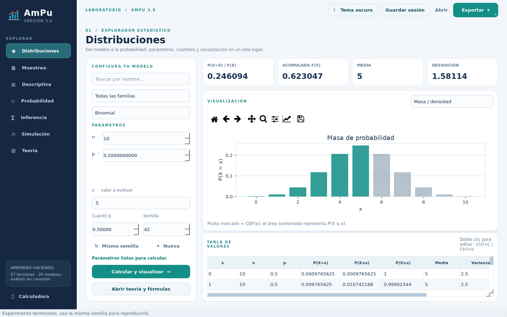
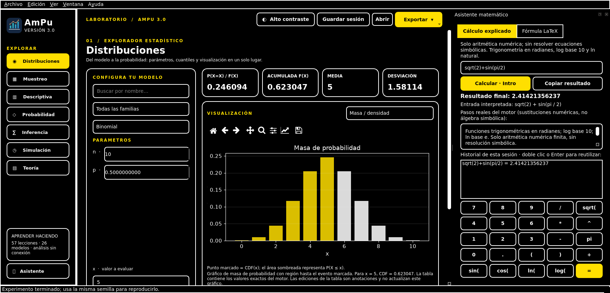
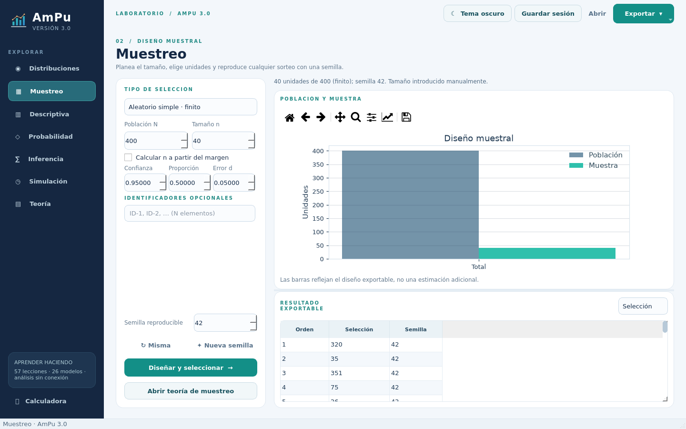
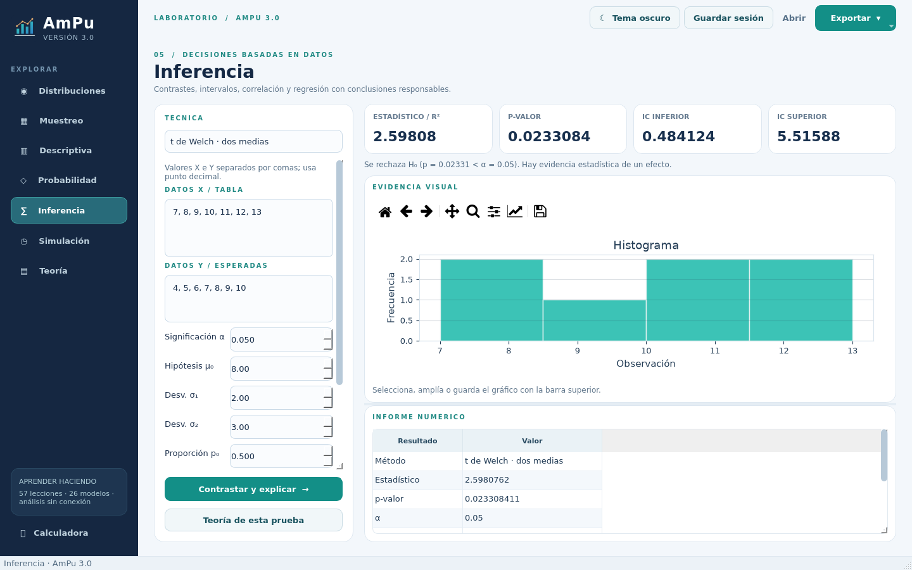
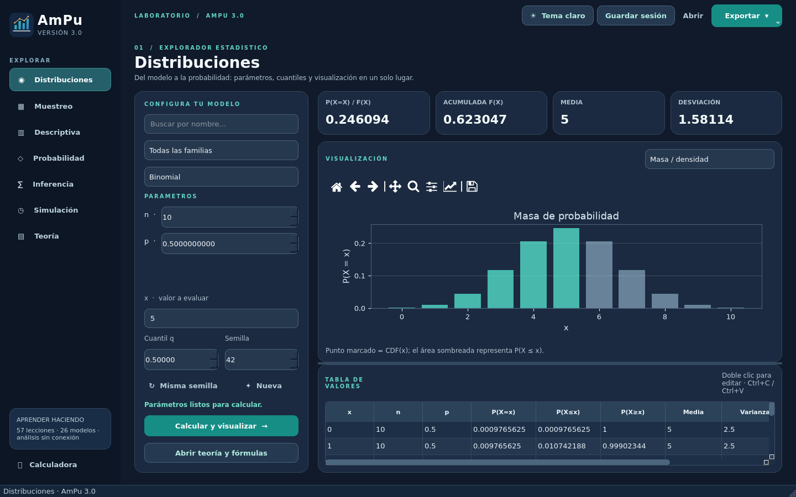

# AmPu 3.0

**Laboratorio de probabilidad y estadística de escritorio, en español y sin conexión.** Una reimplementación multiplataforma de AmPu 2.0 con un motor científico separado de Qt, controles claros, resultados reproducibles y teoría consultable durante el análisis. El árbol Java original sigue intacto.



[](docs/capturas/05_accesibilidad_contraste.png)

| Diseño muestral | Inferencia | Tema oscuro |
|---|---|---|
| [](docs/capturas/02_muestreo_claro.png) | [](docs/capturas/03_inferencia_claro.png) | [](docs/capturas/04_distribuciones_oscuro.png) |

## Instalar y ejecutar

Se necesita **Python 3.12 o posterior**, un sistema con entorno gráfico y las bibliotecas nativas habituales de Qt/QtWebEngine. En Linux instale las bibliotecas gráficas de su distribución: OpenGL/EGL, `libxkbcommon`, D-Bus, NSS/NSPR, ALSA y dependencias X11/XCB/GBM de QtWebEngine (p. ej., en Debian/Ubuntu: `libgl1 libegl1 libxkbcommon0 libdbus-1-3 libnss3 libnspr4 libasound2 libgbm1 libxcomposite1 libxdamage1 libxfixes3 libxrandr2 libxtst6 libxkbfile1`). El entorno de evaluación minimalista no trae todas estas bibliotecas de serie; **no se requieren rutas exclusivas de Windows ni acceso a Internet al ejecutar la aplicación**. En macOS/Windows basta con una instalación normal de Python y el entorno de escritorio del sistema.

Desde esta carpeta (`AmPu 3.0/`):

```bash
python3.12 -m venv .venv
# Linux/macOS:
. .venv/bin/activate
# Windows (PowerShell): .venv\Scripts\Activate.ps1
python -m pip install -r requirements.txt
python -m ampu
```

También se instala el comando `ampu`. `python -m ampu --version` funciona incluso sin servidor gráfico. El primer `pip install` sí necesita una fuente de paquetes; después, los recursos de lectura, fórmulas y fuentes se cargan **localmente**. Para facilitar la instalación manual: `python -m pip install -e .[dev]` instala los mismos extras de desarrollo.

### Primer recorrido

1. En **Distribuciones** elige una familia, cambia `n`, `p`, `x` o `q` y pulsa **Calcular y visualizar**. La tabla presenta la PMF/PDF, CDF, cola inclusiva, momentos y parámetros; la gráfica alterna masa/densidad y acumulada.
2. En **Muestreo** define población, tamaño y semilla, o activa el cálculo automático del tamaño; compara el diseño visualmente y abre las hojas de asignación/selección.
3. En **Descriptiva**, **Probabilidad**, **Inferencia** o **Simulación** pega números separados por coma/espacio, pulsa la acción principal y explora resultados y gráfico.
4. Usa **Abrir teoría** para ver fórmulas, ejemplos resueltos, figuras y fuentes; filtra lecciones en **Teoría**. `Ctrl+1…7` cambia de módulo, `F1` abre la lección correspondiente y `Ctrl+L` muestra el **asistente matemático** en un panel no modal. En **Cálculo explicado** admite aritmética numérica restringida (no es un CAS); enseña entrada interpretada, supuestos, sustituciones numeradas y resultado copiable. En **Fórmula LaTeX** edita/pega código, usa plantillas o autocompleta `\frac`, `\sqrt` y otros comandos; la vista local KaTeX produce MathML cuando QtWebEngine está disponible. La pestaña LaTeX **no calcula** fórmulas.
5. **Exportar** produce XLSX (todas las hojas), CSV UTF-8 (hoja visible), PNG (gráfico) o PDF (informe con fórmula, tabla y figura). **Guardar sesión** conserva entradas incluso incompletas, tablas editadas de **todas** las hojas, hoja activa, semilla, asistente y tema como JSON versionado; **Abrir** restaura la sesión local. Los cambios sin guardar se señalan en el título y se ofrecen Guardar/Descartar/Cancelar antes de abrir otra sesión o cerrar. Las celdas editadas son anotaciones exportables: **no cambian** las estadísticas ni el gráfico, que se recalculan desde entradas y semilla. La tabla muestra números abreviados con valor exacto en el tooltip; el CSV conserva la precisión de Python y XLSX se rige por el límite de ~15 dígitos de Excel. Texto pegado con prefijos de fórmula se exporta como texto, nunca como una fórmula ejecutable.

## Cobertura funcional

- **26 distribuciones** descubiertas desde `core/distribuciones/registro.py` — **8 discretas** (Bernoulli, binomial, binomial negativa, multinomial, geométrica, hipergeométrica, Poisson, uniforme discreta) y **18 continuas** (uniforme, normal estándar/general/bivariada, chi-cuadrado, exponencial, t, F, gamma, Erlang, beta, lognormal, Weibull, Cauchy, logística, triangular, Pareto, Dirichlet). API uniforme `pmf`/`pdf`, `cdf`, `ppf`, `media`, `varianza`, `desviacion`, `rvs`, `soporte` y `validar`. Las CDF y PPF multivariadas siguen la convención explícita de [PLAN.md](PLAN.md).
- **Muestreo:** aleatorio simple finito y con reemplazo, sistemático, estratificado proporcional/Neyman/óptimo y conglomerados de una o dos etapas; tamaño automático de proporciones con corrección finita, tamaños para medias/diferencias y semilla reproducible.
- **Descriptiva y probabilidad:** frecuencias, tendencia central, dispersión, percentiles, combinatoria exacta, probabilidades condicional y total, Bayes, esperanza, varianza y MGF.
- **Inferencia:** 16 técnicas entre z/t de una/dos muestras, z de proporciones, chi-cuadrado, ANOVA, Pearson/Spearman, regresión simple/múltiple, Mann–Whitney, Wilcoxon y Kruskal–Wallis; intervalos de confianza y conclusiones que distinguen «no se rechaza» de «se acepta». La prueba KS posterior a un ajuste se marca **exploratoria**, sin corrección por estimación.
- **Simulación:** π, integración Monte Carlo, muestras, ajuste por máxima verosimilitud de cinco familias y QQ-plot con datos reales; intervalos y errores estándar donde corresponde.
- **Teoría:** 57 lecciones Markdown+LaTeX, 31 figuras, KaTeX 0.16.22 y STIX Two Math locales con temas claro/oscuro/alto contraste, índice y búsqueda en `QWebEngineView`. El asistente evalúa solo aritmética numérica mediante AST restringido; su editor LaTeX genera MathML sin invocar procesos externos.

La **UI no implementa las fórmulas**: prepara entradas, envía trabajos a hilos Qt y presenta la salida calculada por `core/`. NumPy/SciPy/pandas ejecutan los métodos; Matplotlib QtAgg, PySide6, openpyxl y ReportLab cubren presentación y exportaciones.

## Accesibilidad, teclado y recuperación

- **Menús completos** Archivo/Edición/Ver/Ventana/Ayuda, con roles App nativos de Qt en macOS (pendiente confirmar en macOS real). Acciones con atajos visibles y estándar Ctrl/Cmd; `F2` muestra los más usados. Edición se aplica al campo/tabla enfocado y la misma acción Exportar gobierna botón y menú. `Ctrl+,` abre Preferencias; `Shift+F6` activa alto contraste; `Ctrl++`, `Ctrl+-` y `Ctrl+0` ajustan/restablecen el texto entre 90 % y 200 %.
- El modo **Seguir sistema** usa color claro/oscuro de Qt, fuente de la aplicación y la bandera de alto contraste de Windows cuando está disponible; en macOS/Linux el alto contraste también se puede seleccionar **manualmente**. Sin animaciones obligatorias. Formularios y KPI refluyen, las vistas analíticas desplazan contenido verticalmente, el panel lateral puede plegarse y, si el espacio a zoom alto no alcanza, el asistente pasa a ventana flotante. Las gráficas incluyen ejes, texto descriptivo, tabla alternativa y no se exportan cuando las entradas cambiaron sin recalcular.
- Deshacer/rehacer y copiar/pegar funcionan en texto/tabla; los cambios en tablas **son anotaciones**, no cálculos. Una sesión guardada incluye entradas a medio escribir y fórmulas editables. Al abrir o cerrar con cambios pendientes se pregunta antes de perderlos; una carga fallida intenta volver al estado anterior. Salir comprueba todas las ventanas antes de cerrar alguna.
- **Puerta de publicación:** pruebas reales en Windows, macOS y Linux con QtWebEngine, lector de pantalla (NVDA/JAWS/VoiceOver), teclado y preferencias de accesibilidad de cada SO. El sandbox sin bibliotecas NSS/X11/GL no permite certificar el MathML ni el foco nativo; consulta la [auditoría UI/UX/IX con evidencias, severidades y criterios de aceptación](docs/AUDITORIA_UI_UX_IX.md). No atribuir estas comprobaciones al test offscreen.

## Desarrollo y verificación

```bash
python -m pytest
python -m pytest --cov=ampu.core --cov-branch --cov-report=term-missing
python scripts/validar_contra_scipy.py
python -m ampu --verify-resources  # lecciones, figuras, fuentes, exportaciones y sesión; no abre Qt
python -m ampu --self-test         # requiere escritorio completo; comprueba Chromium, KaTeX, imagen y tema
```

Verificado en Python **3.12.11**, NumPy **2.5.4**, SciPy **1.18.1**, pandas **3.1.0**, PySide6 **6.12.0**: **148 pruebas aprobadas**, **1 módulo WebEngine omitido por falta de bibliotecas gráficas nativas**, **92 % de cobertura del núcleo con ramas** (objetivo ≥85 %) y **121/121** comparaciones contra SciPy. Las pruebas de QWidget se ejecutaron en plataforma offscreen con suplentes gráficos **solo de pruebas** y un SQLite temporal para coverage; estos **no forman parte del proyecto ni de sus ejecutables**. `tests/test_webengine.py` usa Chromium real, nunca mocks: se omite solo si no puede importar sus bibliotecas nativas; en un equipo preparado, un error de fórmula, CSS, imagen o paleta hará fallar la prueba. **La autoprueba `--self-test` nunca omite WebEngine**: falla con código no cero si la vista no renderiza. En este sandbox minimalista no se ha podido ejecutar esa autoprueba visual; no se confunde una prueba omitida con una validación exitosa.

Los ejemplos originales Java se comparan en [`tests/test_paridad_java.py`](tests/test_paridad_java.py). Los resultados que eran erróneos **no se copian**: consulta [MIGRACION.md](MIGRACION.md) para fórmulas, casos y diferencias. La ubicación de archivos y alcance se explican en [PLAN.md](PLAN.md). Las contribuciones y convenciones están en [CONTRIBUTING.md](CONTRIBUTING.md).

## Empaquetar

```bash
python scripts/build_exe.py                 # archivo en Linux/Windows, .app en macOS
python scripts/build_exe.py --onedir        # carpeta en Linux/Windows
python scripts/build_exe.py --gui-self-test # NECESITA escritorio nativo completo
# O para revisar el renderizado y obtener una captura real (no sintética):
python -m ampu --self-test --capture-theory docs/capturas/05_teoria_oscuro.png
```

Cada sistema **debe compilar en el propio sistema**: PyInstaller no crea un `.exe` de Windows desde Linux. El script incorpora lecciones, imágenes, KaTeX, fuentes, QSS, iconos nativos ICO/ICNS y `QtWebEngineProcess` con hooks; usa rutas relativas a `__file__`. Tras compilar ejecuta el **binario generado** con `--version` y `--verify-resources` y falla si faltan el helper/recursos Chromium o si una exportación/sesión no funciona. `--gui-self-test` añade una prueba estricta de WebEngine, fórmulas, CSS, figura local y tema oscuro en el **ejecutable**, no en el Python de desarrollo. `dist/` se ignora; conserva el ejecutable solo después de probarlo en un escritorio nativo.

En este sandbox se construyeron y pasaron la autoprueba **ambos modos Linux** (`--onefile` y `--onedir`), sin incluir suplentes gráficos; PyInstaller advirtió que faltan dependencias nativas (`libnss3`, GL/EGL, X11, etc.). **No se ha verificado el funcionamiento visual de esos ejecutables ni se han compilado Windows/macOS aquí**. Para dar por publicable cada artefacto, ejecuta `python scripts/build_exe.py --gui-self-test` *en cada SO de destino* con sus dependencias gráficas instaladas y revisa la captura con `--capture-theory`. Estas pruebas de escritorio son una puerta de publicación, no una afirmación de portabilidad desde Linux minimalista.

## Estructura

```text
AmPu 3.0/
├── src/ampu/
│   ├── core/              # validación, modelos, muestreo, estadística, simulación
│   ├── io/                # Excel/CSV/PNG/PDF y sesiones JSON
│   ├── docs/              # 57 lecciones, 31 imágenes y motor KaTeX offline
│   ├── ui/                # siete vistas, componentes, temas e icono
│   ├── app.py             # QApplication, logging rotativo y entrada
│   └── __main__.py        # python -m ampu
├── tests/                 # SciPy, bordes, exportaciones, teoría y Qt opcional
├── scripts/               # editor de teoría, validador, capturas y PyInstaller
├── docs/capturas/         # PNG genuinos de QWidget con resultados terminados
├── PLAN.md
├── MIGRACION.md
├── CHANGELOG.md
└── CONTRIBUTING.md
```

**Licencias:** el código Python nuevo está bajo MIT ([LICENSE](LICENSE)); KaTeX incluye su MIT en [`LICENSE.katex`](src/ampu/docs/render/LICENSE.katex) y STIX Two Math su OFL en [`LICENSE.stix`](src/ampu/docs/render/LICENSE.stix). El proyecto Java original conserva su situación de derechos previa; no se ha incorporado ni modificado su código.
