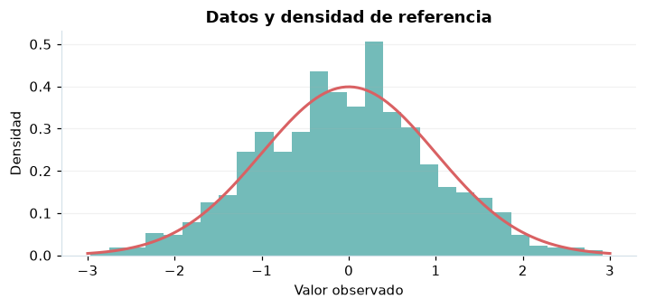

# Probabilidad condicional y Bayes

## Definición formal

Actualiza la probabilidad de una hipótesis tras una observación mediante una partición exhaustiva.

## Parámetros y rango

| Parámetro | Significado y rango |
|---|---|
| `Bᵢ` | Hipótesis disjuntas que suman 1 |
| `A` | Evidencia de probabilidad positiva |

## Función, estadístico o regla de selección

$$
P(B_i\mid A)=\frac{P(A\mid B_i)P(B_i)}{\sum_jP(A\mid B_j)P(B_j)}
$$

## Función de distribución acumulada (CDF)

CDF de referencia o del estimador bajo las hipótesis indicadas.

$$
F_{I_A}(t)=\begin{cases}0,&t<0\\1-P(A),&0\le t<1\\1,&t\ge1\end{cases}
$$

## Media, varianza y desviación estándar

$$
\operatorname{E}[I_A]=P(A),\quad\operatorname{Var}(I_A)=P(A)(1-P(A))
$$

Si no se explicita $\sigma=\sqrt{\operatorname{Var}}$, se obtiene como raíz cuadrada de la varianza; cuando no existe, no debe reportarse un valor numérico.

## Propiedades y casos especiales

Dos eventos son independientes si $P(A\cap B)=P(A)P(B)$; condicionar en un evento imposible no está definido.

*Figura 1. Representación orientativa del procedimiento o de su distribución de referencia.*

## Ejemplo resuelto, paso a paso

1. Priori (0,4;0,6), verosimilitudes (0,5;0,1).
2. Probabilidad total de evidencia $=0,4·0,5+0,6·0,1=0,26$.
3. Posterior de la primera hipótesis $=0,20/0,26\approx0,769$.

## Referencias

- Cochran, W. G. (1977). *Sampling Techniques* (3.ª ed.). Wiley.
- Casella, G., & Berger, R. L. (2002). *Statistical Inference* (2.ª ed.). Duxbury.
- Virtanen, P., et al. (2020). SciPy 1.0: Fundamental algorithms for scientific computing in Python. *Nature Methods, 17*, 261–272. https://doi.org/10.1038/s41592-019-0686-2
