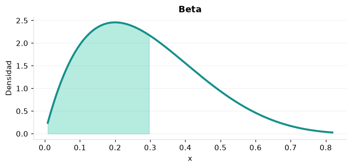

# Beta

## Definición formal

Familia flexible de probabilidades/proporciones en el intervalo unitario. En AmPu 3.0 se parametriza exactamente como en `scipy.stats`;
los eventos fuera del soporte reciben masa/densidad 0.

## Parámetros y rango

| Parámetro | Significado | Rango | Valor de ejemplo |
|---|---|---|---|
| `alpha` | Forma α | > 0; sin límite | `2.0` |
| `beta` | Forma β | > 0; sin límite | `5.0` |

## Función de densidad (PDF)

$$
f(x)=\frac{x^{\alpha-1}(1-x)^{\beta-1}}{B(\alpha,\beta)},\quad 0<x<1
$$

## Función de distribución acumulada (CDF)

$$
F(x)=I_x(\alpha,\beta)
$$

En general, la CDF es $F(x)=P(X\le x)$. Para una variable continua,
$P(a\le X\le b)=F(b)-F(a)$; para una discreta los extremos se incluyen
según los saltos de su CDF. Para una cola superior, consulte la función de supervivencia; no sume densidades continuas.

## Media, varianza y desviación estándar

$$
\operatorname{E}[X]=\frac{\alpha}{\alpha+\beta}
$$

$$
\operatorname{Var}(X)=\frac{\alpha\beta}{(\alpha+\beta)^2(\alpha+\beta+1)}
$$

$$
\sigma_X=\sqrt{\operatorname{Var}(X)}
$$

En modelos multivariados los momentos anteriores son **por componente**.
Si el momento no existe, la desviación tampoco está definida.

## Propiedades y casos especiales

$\alpha=\beta=1$ recupera la uniforme $(0,1)$. Conjugada de Bernoulli/binomial en inferencia bayesiana.

*Figura 1. Curva teórica o primera marginal ilustrativa para Beta; no sustituye a la densidad conjunta de un modelo multivariante.*

## Ejemplo resuelto, paso a paso

1. Configure `alpha=2.0`, `beta=5.0` y el evento $x=0.3$.
2. Sustituya los parámetros en la fórmula de densidad (PDF); obtenga densidad (no probabilidad puntual) **2.1609**.
3. Evalúe la CDF en ese mismo evento: **0.579825**. Para una cola superior, consulte la función de supervivencia; no sume densidades continuas.
4. Interprete unidades y soporte antes de comunicar el resultado; la UI conserva todos los decimales internos.

## Referencias

- Ross, S. M. (2019). *A First Course in Probability* (10.ª ed.). Pearson.
- Casella, G., & Berger, R. L. (2002). *Statistical Inference* (2.ª ed.). Duxbury.
- Virtanen, P., et al. (2020). SciPy 1.0: Fundamental algorithms for scientific computing in Python. *Nature Methods, 17*, 261–272. https://doi.org/10.1038/s41592-019-0686-2
