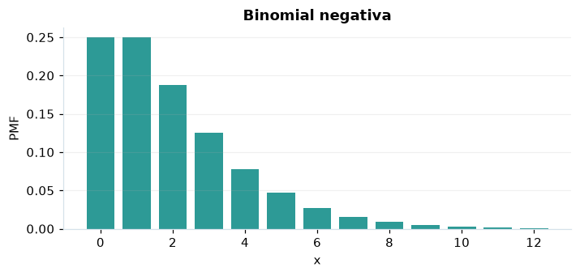

# Binomial negativa

## Definición formal

Cuenta el número de **fracasos** antes de alcanzar el éxito número $r$. En AmPu 3.0 se parametriza exactamente como en `scipy.stats`;
los eventos fuera del soporte reciben masa/densidad 0.

## Parámetros y rango

| Parámetro | Significado | Rango | Valor de ejemplo |
|---|---|---|---|
| `r` | Éxitos esperados | ≥ 1; sin límite | `2` |
| `p` | Probabilidad de éxito | > 0; ≤ 1 | `0.5` |

## Función de masa (PMF)

$$
P(X=x)=\binom{r+x-1}{x}p^r(1-p)^x,\quad x=0,1,\ldots
$$

## Función de distribución acumulada (CDF)

$$
F(x)=\sum_{k=0}^{\lfloor x\rfloor}\binom{r+k-1}{k}p^r(1-p)^k
$$

En general, la CDF es $F(x)=P(X\le x)$. Para una variable continua,
$P(a\le X\le b)=F(b)-F(a)$; para una discreta los extremos se incluyen
según los saltos de su CDF. Para una cola superior, consulte la función de supervivencia; no sume densidades continuas.

## Media, varianza y desviación estándar

$$
\operatorname{E}[X]=\frac{r(1-p)}{p}
$$

$$
\operatorname{Var}(X)=\frac{r(1-p)}{p^2}
$$

$$
\sigma_X=\sqrt{\operatorname{Var}(X)}
$$

En modelos multivariados los momentos anteriores son **por componente**.
Si el momento no existe, la desviación tampoco está definida.

## Propiedades y casos especiales

Con $r=1$ se convierte en geométrica de fracasos (que difiere en 1 de la geométrica de intentos). $p=1$ produce siempre 0 fracasos.

*Figura 1. Curva teórica o primera marginal ilustrativa para Binomial negativa; no sustituye a la densidad conjunta de un modelo multivariante.*

## Ejemplo resuelto, paso a paso

1. Configure `r=2`, `p=0.5` y el evento $x=3$.
2. Sustituya los parámetros en la fórmula de masa (PMF); obtenga probabilidad **0.125**.
3. Evalúe la CDF en ese mismo evento: **0.8125**. Para una cola superior, consulte la función de supervivencia; no sume densidades continuas.
4. Interprete unidades y soporte antes de comunicar el resultado; la UI conserva todos los decimales internos.

## Referencias

- Ross, S. M. (2019). *A First Course in Probability* (10.ª ed.). Pearson.
- Casella, G., & Berger, R. L. (2002). *Statistical Inference* (2.ª ed.). Duxbury.
- Virtanen, P., et al. (2020). SciPy 1.0: Fundamental algorithms for scientific computing in Python. *Nature Methods, 17*, 261–272. https://doi.org/10.1038/s41592-019-0686-2
