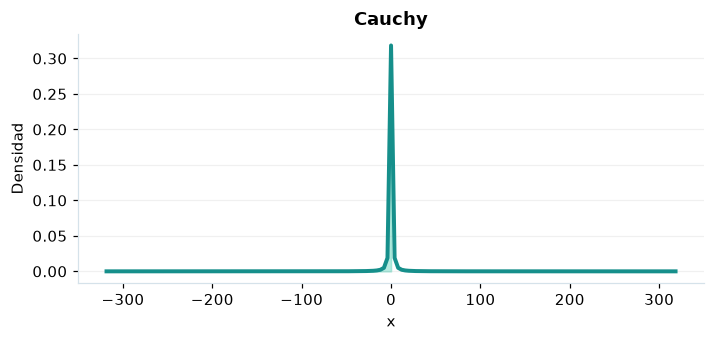

# Cauchy

## Definición formal

Distribución de colas muy pesadas, centrada en $x_0$ y de escala $\gamma$. En AmPu 3.0 se parametriza exactamente como en `scipy.stats`;
los eventos fuera del soporte reciben masa/densidad 0.

## Parámetros y rango

| Parámetro | Significado | Rango | Valor de ejemplo |
|---|---|---|---|
| `centro` | Ubicación x₀ | sin límite; sin límite | `0.0` |
| `escala` | Escala γ | > 0; sin límite | `1.0` |

## Función de densidad (PDF)

$$
f(x)=\frac{1}{\pi\gamma[1+((x-x_0)/\gamma)^2]}
$$

## Función de distribución acumulada (CDF)

$$
F(x)=\frac12+\frac1\pi\arctan\left(\frac{x-x_0}{\gamma}\right)
$$

En general, la CDF es $F(x)=P(X\le x)$. Para una variable continua,
$P(a\le X\le b)=F(b)-F(a)$; para una discreta los extremos se incluyen
según los saltos de su CDF. Para una cola superior, consulte la función de supervivencia; no sume densidades continuas.

## Media, varianza y desviación estándar

$$
\operatorname{E}[X]=\text{indefinida}
$$

$$
\operatorname{Var}(X)=\text{indefinida}
$$

$$
\sigma_X=\sqrt{\operatorname{Var}(X)}
$$

En modelos multivariados los momentos anteriores son **por componente**.
Si el momento no existe, la desviación tampoco está definida.

## Propiedades y casos especiales

Ni la media ni la desviación están definidas; SciPy devuelve NaN. Su mediana es $x_0$. Es t de Student con un grado de libertad.

*Figura 1. Curva teórica o primera marginal ilustrativa para Cauchy; no sustituye a la densidad conjunta de un modelo multivariante.*

## Ejemplo resuelto, paso a paso

1. Configure `centro=0.0`, `escala=1.0` y el evento $x=1$.
2. Sustituya los parámetros en la fórmula de densidad (PDF); obtenga densidad (no probabilidad puntual) **0.159155**.
3. Evalúe la CDF en ese mismo evento: **0.75**. Para una cola superior, consulte la función de supervivencia; no sume densidades continuas.
4. Interprete unidades y soporte antes de comunicar el resultado; la UI conserva todos los decimales internos.

## Referencias

- Ross, S. M. (2019). *A First Course in Probability* (10.ª ed.). Pearson.
- Casella, G., & Berger, R. L. (2002). *Statistical Inference* (2.ª ed.). Duxbury.
- Virtanen, P., et al. (2020). SciPy 1.0: Fundamental algorithms for scientific computing in Python. *Nature Methods, 17*, 261–272. https://doi.org/10.1038/s41592-019-0686-2
