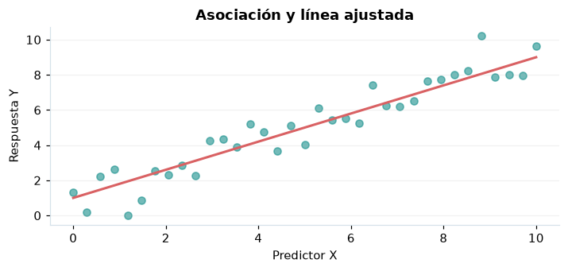

# Correlación de Pearson y Spearman

## Definición formal

Pearson mide asociación lineal; Spearman mide asociación monótona usando rangos.

## Parámetros y rango

| Parámetro | Significado y rango |
|---|---|
| `xᵢ,yᵢ` | Observaciones pareadas, n≥3 |
| `r` | Coeficiente de Pearson |
| `ρₛ` | Coeficiente de Spearman |

## Función, estadístico o regla de selección

$$
r=\frac{\sum_i(x_i-\bar x)(y_i-\bar y)}{\sqrt{\sum_i(x_i-\bar x)^2\sum_i(y_i-\bar y)^2}}
$$

## Función de distribución acumulada (CDF)

CDF de referencia o del estimador bajo las hipótesis indicadas.

$$
F_T(t)=F_{t_{n-2}}(t),\quad T=r\sqrt{\frac{n-2}{1-r^2}}\ (H_0:r=0)
$$

## Media, varianza y desviación estándar

$$
\operatorname{E}[T]=0\ (n>3),\quad\operatorname{Var}(T)=\frac{n-2}{n-4}\ (n>4)
$$

Si no se explicita $\sigma=\sqrt{\operatorname{Var}}$, se obtiene como raíz cuadrada de la varianza; cuando no existe, no debe reportarse un valor numérico.

## Propiedades y casos especiales

La correlación no implica causalidad. Spearman usa permutación/rangos; su p se obtiene en SciPy según tamaño.

*Figura 1. Representación orientativa del procedimiento o de su distribución de referencia.*

## Ejemplo resuelto, paso a paso

1. Registre $x=(1,2,3)$ e $y=(2,4,6)$.
2. Pearson $r=1$ y Spearman $\rho_s=1$ por orden idéntico.
3. Informe la magnitud y advierta que una muestra pequeña no establece causalidad.

## Referencias

- Cochran, W. G. (1977). *Sampling Techniques* (3.ª ed.). Wiley.
- Casella, G., & Berger, R. L. (2002). *Statistical Inference* (2.ª ed.). Duxbury.
- Virtanen, P., et al. (2020). SciPy 1.0: Fundamental algorithms for scientific computing in Python. *Nature Methods, 17*, 261–272. https://doi.org/10.1038/s41592-019-0686-2
