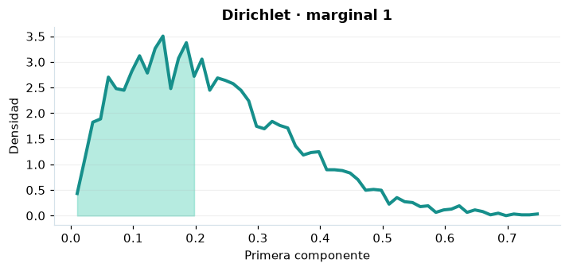

# Dirichlet

## Definición formal

Distribución de un vector de proporciones positivas que suman exactamente uno. En AmPu 3.0 se parametriza exactamente como en `scipy.stats`;
los eventos fuera del soporte reciben masa/densidad 0.

## Parámetros y rango

| Parámetro | Significado | Rango | Valor de ejemplo |
|---|---|---|---|
| `alpha` | Concentraciones positivas | > 0; sin límite | `(2.0, 3.0, 4.0)` |

## Función de densidad (PDF)

$$
f(\boldsymbol x)=\frac{\Gamma(\alpha_0)}{\prod_i\Gamma(\alpha_i)}\prod_i x_i^{\alpha_i-1},\quad\alpha_0=\sum_i\alpha_i,\ \sum_i x_i=1
$$

## Función de distribución acumulada (CDF)

$$
F_i(t)=I_t(\alpha_i,\alpha_0-\alpha_i)
$$

En general, la CDF es $F(x)=P(X\le x)$. Para una variable continua,
$P(a\le X\le b)=F(b)-F(a)$; para una discreta los extremos se incluyen
según los saltos de su CDF. Las CDF mostradas son marginales por componente, no una CDF conjunta.

## Media, varianza y desviación estándar

$$
\operatorname{E}[X_i]=\frac{\alpha_i}{\alpha_0}
$$

$$
\operatorname{Var}(X_i)=\frac{\alpha_i(\alpha_0-\alpha_i)}{\alpha_0^2(\alpha_0+1)}
$$

$$
\sigma_X=\sqrt{\operatorname{Var}(X)}
$$

En modelos multivariados los momentos anteriores son **por componente**.
Si el momento no existe, la desviación tampoco está definida.

## Propiedades y casos especiales

Sus marginales son beta; la CDF/PPF de AmPu son **marginales**, no conjuntas. Para dos componentes equivale a una beta.

*Figura 1. Curva teórica o primera marginal ilustrativa para Dirichlet; no sustituye a la densidad conjunta de un modelo multivariante.*

## Ejemplo resuelto, paso a paso

1. Configure `alpha=(2.0, 3.0, 4.0)` y el evento $x=0.2, 0.3, 0.5$.
2. Sustituya los parámetros en la fórmula de densidad (PDF); obtenga densidad (no probabilidad puntual) **7.56**.
3. Evalúe la CDF en ese mismo evento: **0.496684, 0.448226, 0.636719**. Las CDF mostradas son marginales por componente, no una CDF conjunta.
4. Interprete unidades y soporte antes de comunicar el resultado; la UI conserva todos los decimales internos.

## Referencias

- Ross, S. M. (2019). *A First Course in Probability* (10.ª ed.). Pearson.
- Casella, G., & Berger, R. L. (2002). *Statistical Inference* (2.ª ed.). Duxbury.
- Virtanen, P., et al. (2020). SciPy 1.0: Fundamental algorithms for scientific computing in Python. *Nature Methods, 17*, 261–272. https://doi.org/10.1038/s41592-019-0686-2
