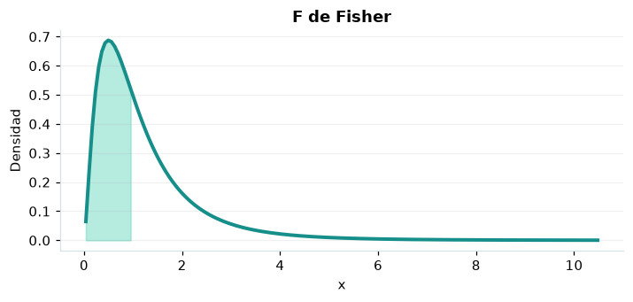

# F de Fisher

## Definición formal

Cociente de dos chi-cuadrados independientes normalizados por sus grados de libertad $d_1,d_2$. En AmPu 3.0 se parametriza exactamente como en `scipy.stats`;
los eventos fuera del soporte reciben masa/densidad 0.

## Parámetros y rango

| Parámetro | Significado | Rango | Valor de ejemplo |
|---|---|---|---|
| `gl1` | Grados de libertad del numerador | > 0; sin límite | `5.0` |
| `gl2` | Grados de libertad del denominador | > 0; sin límite | `10.0` |

## Función de densidad (PDF)

$$
f(x)=\frac{(d_1/d_2)^{d_1/2}x^{d_1/2-1}}{B(d_1/2,d_2/2)(1+d_1x/d_2)^{(d_1+d_2)/2}},\quad x>0
$$

## Función de distribución acumulada (CDF)

$$
F(x)=I_{d_1x/(d_1x+d_2)}(d_1/2,d_2/2)
$$

En general, la CDF es $F(x)=P(X\le x)$. Para una variable continua,
$P(a\le X\le b)=F(b)-F(a)$; para una discreta los extremos se incluyen
según los saltos de su CDF. Para una cola superior, consulte la función de supervivencia; no sume densidades continuas.

## Media, varianza y desviación estándar

$$
\operatorname{E}[X]=\frac{d_2}{d_2-2}\ (d_2>2)
$$

$$
\operatorname{Var}(X)=\frac{2d_2^2(d_1+d_2-2)}{d_1(d_2-2)^2(d_2-4)}\ (d_2>4)
$$

$$
\sigma_X=\sqrt{\operatorname{Var}(X)}
$$

En modelos multivariados los momentos anteriores son **por componente**.
Si el momento no existe, la desviación tampoco está definida.

## Propiedades y casos especiales

La cola derecha es habitual en ANOVA. En SciPy los grados de libertad son parámetros, no constantes hardcodeadas.

*Figura 1. Curva teórica o primera marginal ilustrativa para F de Fisher; no sustituye a la densidad conjunta de un modelo multivariante.*

## Ejemplo resuelto, paso a paso

1. Configure `gl1=5.0`, `gl2=10.0` y el evento $x=1$.
2. Sustituya los parámetros en la fórmula de densidad (PDF); obtenga densidad (no probabilidad puntual) **0.49548**.
3. Evalúe la CDF en ese mismo evento: **0.534881**. Para una cola superior, consulte la función de supervivencia; no sume densidades continuas.
4. Interprete unidades y soporte antes de comunicar el resultado; la UI conserva todos los decimales internos.

## Referencias

- Ross, S. M. (2019). *A First Course in Probability* (10.ª ed.). Pearson.
- Casella, G., & Berger, R. L. (2002). *Statistical Inference* (2.ª ed.). Duxbury.
- Virtanen, P., et al. (2020). SciPy 1.0: Fundamental algorithms for scientific computing in Python. *Nature Methods, 17*, 261–272. https://doi.org/10.1038/s41592-019-0686-2
