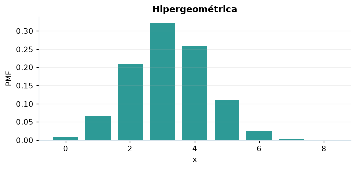

# Hipergeométrica

## Definición formal

Cuenta éxitos en $n$ extracciones **sin reemplazo** de una población de $N$ con $K$ éxitos. En AmPu 3.0 se parametriza exactamente como en `scipy.stats`;
los eventos fuera del soporte reciben masa/densidad 0.

## Parámetros y rango

| Parámetro | Significado | Rango | Valor de ejemplo |
|---|---|---|---|
| `N` | Tamaño de la población | ≥ 1; sin límite | `30` |
| `K` | Éxitos en la población | ≥ 0; sin límite | `12` |
| `n` | Tamaño de la muestra | ≥ 0; sin límite | `8` |

## Función de masa (PMF)

$$
P(X=x)=\frac{\binom Kx\binom{N-K}{n-x}}{\binom Nn}
$$

## Función de distribución acumulada (CDF)

$$
F(x)=\sum_{j=\max(0,n-N+K)}^{\lfloor x\rfloor}\frac{\binom Kj\binom{N-K}{n-j}}{\binom Nn}
$$

En general, la CDF es $F(x)=P(X\le x)$. Para una variable continua,
$P(a\le X\le b)=F(b)-F(a)$; para una discreta los extremos se incluyen
según los saltos de su CDF. Para una cola superior, consulte la función de supervivencia; no sume densidades continuas.

## Media, varianza y desviación estándar

$$
\operatorname{E}[X]=n\frac KN
$$

$$
\operatorname{Var}(X)=n\frac KN\left(1-\frac KN\right)\frac{N-n}{N-1}
$$

$$
\sigma_X=\sqrt{\operatorname{Var}(X)}
$$

En modelos multivariados los momentos anteriores son **por componente**.
Si el momento no existe, la desviación tampoco está definida.

## Propiedades y casos especiales

Soporte: $\max(0,n-N+K)\le x\le\min(n,K)$. La corrección $\frac{N-n}{N-1}$ cuantifica la falta de reemplazo; con $N=1$ la varianza es 0.

*Figura 1. Curva teórica o primera marginal ilustrativa para Hipergeométrica; no sustituye a la densidad conjunta de un modelo multivariante.*

## Ejemplo resuelto, paso a paso

1. Configure `N=30`, `K=12`, `n=8` y el evento $x=3$.
2. Sustituya los parámetros en la fórmula de masa (PMF); obtenga probabilidad **0.322054**.
3. Evalúe la CDF en ese mismo evento: **0.604113**. Para una cola superior, consulte la función de supervivencia; no sume densidades continuas.
4. Interprete unidades y soporte antes de comunicar el resultado; la UI conserva todos los decimales internos.

## Referencias

- Ross, S. M. (2019). *A First Course in Probability* (10.ª ed.). Pearson.
- Casella, G., & Berger, R. L. (2002). *Statistical Inference* (2.ª ed.). Duxbury.
- Virtanen, P., et al. (2020). SciPy 1.0: Fundamental algorithms for scientific computing in Python. *Nature Methods, 17*, 261–272. https://doi.org/10.1038/s41592-019-0686-2
