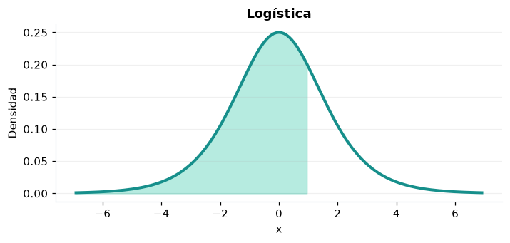

# Logística

## Definición formal

Distribución simétrica con ubicación $\mu$ y escala $s$, de colas más pesadas que la normal. En AmPu 3.0 se parametriza exactamente como en `scipy.stats`;
los eventos fuera del soporte reciben masa/densidad 0.

## Parámetros y rango

| Parámetro | Significado | Rango | Valor de ejemplo |
|---|---|---|---|
| `mu` | Ubicación | sin límite; sin límite | `0.0` |
| `escala` | Escala | > 0; sin límite | `1.0` |

## Función de densidad (PDF)

$$
f(x)=\frac{e^{-(x-\mu)/s}}{s[1+e^{-(x-\mu)/s}]^2}
$$

## Función de distribución acumulada (CDF)

$$
F(x)=\frac{1}{1+e^{-(x-\mu)/s}}
$$

En general, la CDF es $F(x)=P(X\le x)$. Para una variable continua,
$P(a\le X\le b)=F(b)-F(a)$; para una discreta los extremos se incluyen
según los saltos de su CDF. Para una cola superior, consulte la función de supervivencia; no sume densidades continuas.

## Media, varianza y desviación estándar

$$
\operatorname{E}[X]=\mu
$$

$$
\operatorname{Var}(X)=\frac{\pi^2s^2}{3}
$$

$$
\sigma_X=\sqrt{\operatorname{Var}(X)}
$$

En modelos multivariados los momentos anteriores son **por componente**.
Si el momento no existe, la desviación tampoco está definida.

## Propiedades y casos especiales

El logit de una probabilidad uniforme tiene distribución logística estándar. CDF y función logística coinciden.

*Figura 1. Curva teórica o primera marginal ilustrativa para Logística; no sustituye a la densidad conjunta de un modelo multivariante.*

## Ejemplo resuelto, paso a paso

1. Configure `mu=0.0`, `escala=1.0` y el evento $x=1$.
2. Sustituya los parámetros en la fórmula de densidad (PDF); obtenga densidad (no probabilidad puntual) **0.196612**.
3. Evalúe la CDF en ese mismo evento: **0.731059**. Para una cola superior, consulte la función de supervivencia; no sume densidades continuas.
4. Interprete unidades y soporte antes de comunicar el resultado; la UI conserva todos los decimales internos.

## Referencias

- Ross, S. M. (2019). *A First Course in Probability* (10.ª ed.). Pearson.
- Casella, G., & Berger, R. L. (2002). *Statistical Inference* (2.ª ed.). Duxbury.
- Virtanen, P., et al. (2020). SciPy 1.0: Fundamental algorithms for scientific computing in Python. *Nature Methods, 17*, 261–272. https://doi.org/10.1038/s41592-019-0686-2
