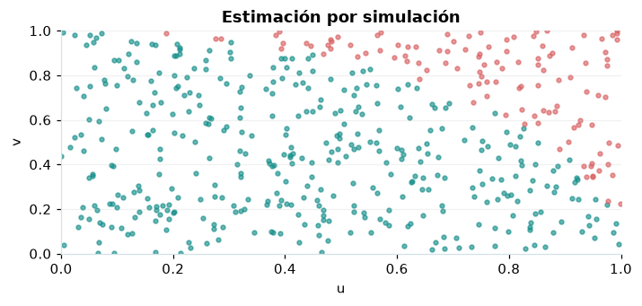

# Integración y simulación Monte Carlo

## Definición formal

Estima integrales o probabilidades por promedios de valores aleatorios con semilla.

## Parámetros y rango

| Parámetro | Significado y rango |
|---|---|
| `N` | Número de simulaciones ≥2 |
| `a,b` | Extremos finitos con a<b |
| `seed` | Semilla para repetir la corrida |

## Función, estadístico o regla de selección

$$
\hat I_N=(b-a)\frac1N\sum_{j=1}^N f(U_j),\quad U_j\sim U(a,b)
$$

## Función de distribución acumulada (CDF)

CDF de referencia o del estimador bajo las hipótesis indicadas.

$$
P(\hat I_N\le t)\approx\Phi\left(\frac{t-I}{\operatorname{SE}(\hat I_N)}\right)
$$

## Media, varianza y desviación estándar

$$
\operatorname{E}[\hat I_N]=I,\quad\operatorname{Var}(\hat I_N)=\frac{(b-a)^2\operatorname{Var}(f(U))}{N}
$$

Si no se explicita $\sigma=\sqrt{\operatorname{Var}}$, se obtiene como raíz cuadrada de la varianza; cuando no existe, no debe reportarse un valor numérico.

## Propiedades y casos especiales

El intervalo normal cubre error de simulación, no sesgos de modelo. En la estimación de π, cuatro veces la fracción de puntos en cuarto de círculo.

*Figura 1. Representación orientativa del procedimiento o de su distribución de referencia.*

## Ejemplo resuelto, paso a paso

1. Genere 10 000 pares uniformes en el cuadrado unitario con semilla 42.
2. Cuente los que cumplen $u^2+v^2\le1$ y multiplique la fracción por 4.
3. Informe estimación de π e intervalo basado en error estándar.

## Referencias

- Cochran, W. G. (1977). *Sampling Techniques* (3.ª ed.). Wiley.
- Casella, G., & Berger, R. L. (2002). *Statistical Inference* (2.ª ed.). Duxbury.
- Virtanen, P., et al. (2020). SciPy 1.0: Fundamental algorithms for scientific computing in Python. *Nature Methods, 17*, 261–272. https://doi.org/10.1038/s41592-019-0686-2
