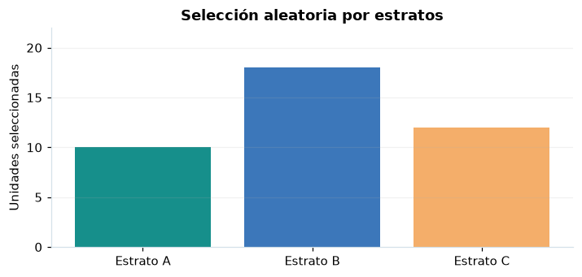

# Asignación óptima con costes

## Definición formal

Extiende Neyman penalizando estratos cuyo coste por observación es mayor.

## Parámetros y rango

| Parámetro | Significado y rango |
|---|---|
| `N_h` | Tamaño de estrato |
| `S_h` | Desviación esperada |
| `c_h` | Coste positivo por unidad |

## Función, estadístico o regla de selección

$$
n_h\approx n\frac{N_hS_h/\sqrt{c_h}}{\sum_j N_jS_j/\sqrt{c_j}}
$$

## Función de distribución acumulada (CDF)

CDF del indicador de inclusión o aproximación de diseño; no existe una única CDF de toda la técnica.

$$
P(I_{hi}\le t)=\begin{cases}0,&t<0\\1-n_h/N_h,&0\le t<1\\1,&t\ge1\end{cases}
$$

## Media, varianza y desviación estándar

$$
\operatorname{E}[I_{hi}]=n_h/N_h,\quad\operatorname{Var}(I_{hi})=(n_h/N_h)(1-n_h/N_h)
$$

Si no se explicita $\sigma=\sqrt{\operatorname{Var}}$, se obtiene como raíz cuadrada de la varianza; cuando no existe, no debe reportarse un valor numérico.

## Propiedades y casos especiales

La fórmula es una asignación con n fijado. La optimización bajo presupuesto fijo es distinta; registrar costes si existen.

*Figura 1. Representación orientativa del procedimiento o de su distribución de referencia.*

## Ejemplo resuelto, paso a paso

1. Use $(N_1,S_1,c_1)=(100,8,1)$ y $(N_2,S_2,c_2)=(200,4,4)$.
2. Los pesos son 800 y 400.
3. Para $n=60$, los tamaños son 40 y 20; seleccione sin reemplazo en cada estrato.

## Referencias

- Cochran, W. G. (1977). *Sampling Techniques* (3.ª ed.). Wiley.
- Casella, G., & Berger, R. L. (2002). *Statistical Inference* (2.ª ed.). Duxbury.
- Virtanen, P., et al. (2020). SciPy 1.0: Fundamental algorithms for scientific computing in Python. *Nature Methods, 17*, 261–272. https://doi.org/10.1038/s41592-019-0686-2
