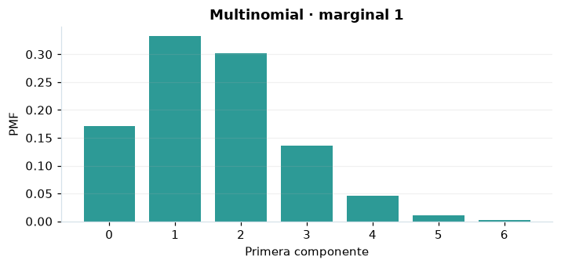

# Multinomial

## Definición formal

Generaliza la binomial a $k$ categorías, con vector de conteos $\boldsymbol X$ y $\sum_i X_i=n$. En AmPu 3.0 se parametriza exactamente como en `scipy.stats`;
los eventos fuera del soporte reciben masa/densidad 0.

## Parámetros y rango

| Parámetro | Significado | Rango | Valor de ejemplo |
|---|---|---|---|
| `n` | Número total de ensayos | ≥ 0; sin límite | `8` |
| `p` | Probabilidades de las categorías (suman 1) | ≥ 0; ≤ 1 | `(0.2, 0.3, 0.5)` |

## Función de masa (PMF)

$$
P(\boldsymbol X=\boldsymbol x)=\begin{cases}\dfrac{n!}{\prod_{i=1}^{k}x_i!}\prod_{i=1}^{k}p_i^{x_i},&\sum_i x_i=n\\0,&\mathrm{en\ otro\ caso}\end{cases}
$$

## Función de distribución acumulada (CDF)

$$
F_i(t)=P(X_i\le t)=\sum_{j=0}^{\lfloor t\rfloor}\binom nj p_i^j(1-p_i)^{n-j}
$$

En general, la CDF es $F(x)=P(X\le x)$. Para una variable continua,
$P(a\le X\le b)=F(b)-F(a)$; para una discreta los extremos se incluyen
según los saltos de su CDF. Las CDF mostradas son marginales por componente, no una CDF conjunta.

## Media, varianza y desviación estándar

$$
\operatorname{E}[X_i]=np_i
$$

$$
\operatorname{Var}(X_i)=np_i(1-p_i)
$$

$$
\sigma_X=\sqrt{\operatorname{Var}(X)}
$$

En modelos multivariados los momentos anteriores son **por componente**.
Si el momento no existe, la desviación tampoco está definida.

## Propiedades y casos especiales

La CDF y PPF que muestra AmPu son **marginales** por categoría, no conjuntas. $\operatorname{Cov}(X_i,X_j)=-np_ip_j$ para $i\ne j$. Se exige $\sum p_i=1$.

*Figura 1. Curva teórica o primera marginal ilustrativa para Multinomial; no sustituye a la densidad conjunta de un modelo multivariante.*

## Ejemplo resuelto, paso a paso

1. Configure `n=8`, `p=(0.2, 0.3, 0.5)` y el evento $x=2, 2, 4$.
2. Sustituya los parámetros en la fórmula de masa (PMF); obtenga probabilidad **0.0945**.
3. Evalúe la CDF en ese mismo evento: **0.796918, 0.551774, 0.636719**. Las CDF mostradas son marginales por componente, no una CDF conjunta.
4. Interprete unidades y soporte antes de comunicar el resultado; la UI conserva todos los decimales internos.

## Referencias

- Ross, S. M. (2019). *A First Course in Probability* (10.ª ed.). Pearson.
- Casella, G., & Berger, R. L. (2002). *Statistical Inference* (2.ª ed.). Duxbury.
- Virtanen, P., et al. (2020). SciPy 1.0: Fundamental algorithms for scientific computing in Python. *Nature Methods, 17*, 261–272. https://doi.org/10.1038/s41592-019-0686-2
