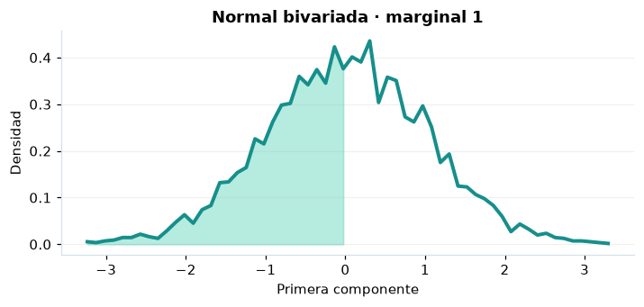

# Normal bivariada

## Definición formal

Par $(X,Y)$ normal con medias, desviaciones y correlación $\rho$; $|\rho|<1$. En AmPu 3.0 se parametriza exactamente como en `scipy.stats`;
los eventos fuera del soporte reciben masa/densidad 0.

## Parámetros y rango

| Parámetro | Significado | Rango | Valor de ejemplo |
|---|---|---|---|
| `mu_x` | Media de X | sin límite; sin límite | `0.0` |
| `mu_y` | Media de Y | sin límite; sin límite | `0.0` |
| `sigma_x` | Desviación de X | > 0; sin límite | `1.0` |
| `sigma_y` | Desviación de Y | > 0; sin límite | `1.0` |
| `rho` | Correlación | > -1; < 1 | `0.4` |

## Función de densidad (PDF)

$$
f(x,y)=\frac{\exp\!\left[-\frac{z_x^2-2\rho z_xz_y+z_y^2}{2(1-\rho^2)}\right]}{2\pi\sigma_x\sigma_y\sqrt{1-\rho^2}},\quad z_i=\frac{x_i-\mu_i}{\sigma_i}
$$

## Función de distribución acumulada (CDF)

$$
F(x,y)=\int_{-\infty}^{x}\int_{-\infty}^{y}f(u,v)\,\mathrm{d}v\,\mathrm{d}u
$$

En general, la CDF es $F(x)=P(X\le x)$. Para una variable continua,
$P(a\le X\le b)=F(b)-F(a)$; para una discreta los extremos se incluyen
según los saltos de su CDF. La CDF mostrada es conjunta para (X,Y).

## Media, varianza y desviación estándar

$$
\operatorname{E}[\boldsymbol X]=(\mu_x,\mu_y)
$$

$$
\operatorname{Var}(X)=\sigma_x^2,\quad\operatorname{Var}(Y)=\sigma_y^2
$$

$$
\sigma_X=\sqrt{\operatorname{Var}(X)}
$$

En modelos multivariados los momentos anteriores son **por componente**.
Si el momento no existe, la desviación tampoco está definida.

## Propiedades y casos especiales

La CDF es **conjunta**; los cuantiles PPF son marginales. $\operatorname{Cov}(X,Y)=\rho\sigma_x\sigma_y$.

*Figura 1. Curva teórica o primera marginal ilustrativa para Normal bivariada; no sustituye a la densidad conjunta de un modelo multivariante.*

## Ejemplo resuelto, paso a paso

1. Configure `mu_x=0.0`, `mu_y=0.0`, `sigma_x=1.0`, `sigma_y=1.0`, `rho=0.4` y el evento $x=0, 0$.
2. Sustituya los parámetros en la fórmula de densidad (PDF); obtenga densidad (no probabilidad puntual) **0.173652**.
3. Evalúe la CDF en ese mismo evento: **0.315495**. La CDF mostrada es conjunta para (X,Y).
4. Interprete unidades y soporte antes de comunicar el resultado; la UI conserva todos los decimales internos.

## Referencias

- Ross, S. M. (2019). *A First Course in Probability* (10.ª ed.). Pearson.
- Casella, G., & Berger, R. L. (2002). *Statistical Inference* (2.ª ed.). Duxbury.
- Virtanen, P., et al. (2020). SciPy 1.0: Fundamental algorithms for scientific computing in Python. *Nature Methods, 17*, 261–272. https://doi.org/10.1038/s41592-019-0686-2
