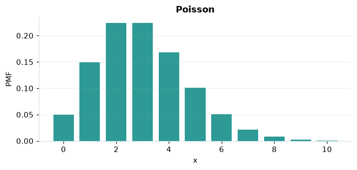

# Poisson

## Definición formal

Número de sucesos en un intervalo, con tasa media $\lambda$ y ocurrencias independientes. En AmPu 3.0 se parametriza exactamente como en `scipy.stats`;
los eventos fuera del soporte reciben masa/densidad 0.

## Parámetros y rango

| Parámetro | Significado | Rango | Valor de ejemplo |
|---|---|---|---|
| `tasa` | Eventos esperados por intervalo (λ) | ≥ 0; sin límite | `3.0` |

## Función de masa (PMF)

$$
P(X=x)=e^{-\lambda}\frac{\lambda^x}{x!},\quad x=0,1,\ldots
$$

## Función de distribución acumulada (CDF)

$$
F(x)=e^{-\lambda}\sum_{k=0}^{\lfloor x\rfloor}\frac{\lambda^k}{k!}
$$

En general, la CDF es $F(x)=P(X\le x)$. Para una variable continua,
$P(a\le X\le b)=F(b)-F(a)$; para una discreta los extremos se incluyen
según los saltos de su CDF. Para una cola superior, consulte la función de supervivencia; no sume densidades continuas.

## Media, varianza y desviación estándar

$$
\operatorname{E}[X]=\lambda
$$

$$
\operatorname{Var}(X)=\lambda
$$

$$
\sigma_X=\sqrt{\operatorname{Var}(X)}
$$

En modelos multivariados los momentos anteriores son **por componente**.
Si el momento no existe, la desviación tampoco está definida.

## Propiedades y casos especiales

Si $\lambda=0$, toda la masa está en 0. Aproxima una binomial cuando $n$ es grande, $p$ pequeño y $np=\lambda$.

*Figura 1. Curva teórica o primera marginal ilustrativa para Poisson; no sustituye a la densidad conjunta de un modelo multivariante.*

## Ejemplo resuelto, paso a paso

1. Configure `tasa=3.0` y el evento $x=5$.
2. Sustituya los parámetros en la fórmula de masa (PMF); obtenga probabilidad **0.100819**.
3. Evalúe la CDF en ese mismo evento: **0.916082**. Para una cola superior, consulte la función de supervivencia; no sume densidades continuas.
4. Interprete unidades y soporte antes de comunicar el resultado; la UI conserva todos los decimales internos.

## Referencias

- Ross, S. M. (2019). *A First Course in Probability* (10.ª ed.). Pearson.
- Casella, G., & Berger, R. L. (2002). *Statistical Inference* (2.ª ed.). Duxbury.
- Virtanen, P., et al. (2020). SciPy 1.0: Fundamental algorithms for scientific computing in Python. *Nature Methods, 17*, 261–272. https://doi.org/10.1038/s41592-019-0686-2
