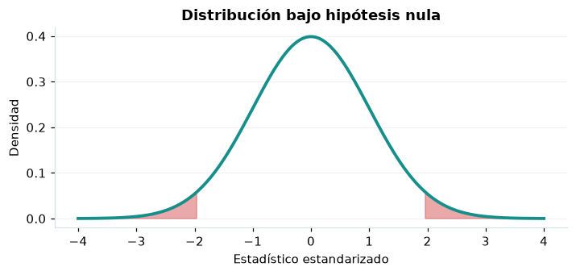

# Prueba t · una media

## Definición formal

Contrasta una media sin conocer la desviación poblacional, con varianza muestral $s^2$.

## Parámetros y rango

| Parámetro | Significado y rango |
|---|---|
| `μ₀` | Media hipotética |
| `n` | Muestra independiente de tamaño ≥2 |
| `s` | Desviación muestral positiva |

## Función, estadístico o regla de selección

$$
T=\frac{\bar X-\mu_0}{s/\sqrt n}\overset{H_0}{\sim}t_{n-1}
$$

## Función de distribución acumulada (CDF)

CDF de referencia o del estimador bajo las hipótesis indicadas.

$$
F_T(t)=\int_{-\infty}^{t}\frac{\Gamma(n/2)}{\sqrt{(n-1)\pi}\,\Gamma((n-1)/2)}\left(1+\frac{u^2}{n-1}\right)^{-n/2}\mathrm{d}u
$$

## Media, varianza y desviación estándar

$$
\operatorname{E}[T]=0\ (n>2),\quad\operatorname{Var}(T)=\frac{n-1}{n-3}\ (n>3)
$$

Si no se explicita $\sigma=\sqrt{\operatorname{Var}}$, se obtiene como raíz cuadrada de la varianza; cuando no existe, no debe reportarse un valor numérico.

## Propiedades y casos especiales

Con muestras pequeñas conviene explorar normalidad; varianza cero no permite prueba t.

*Figura 1. Representación orientativa del procedimiento o de su distribución de referencia.*

## Ejemplo resuelto, paso a paso

1. Para $n=10$, $\bar x=5,8$, $s=1$, $\mu_0=5$: $t=0,8/(1/\sqrt{10})=2,530$.
2. Use 9 grados de libertad y cola bilateral $p\approx0,032$.
3. Como $p<0,05$, rechace H₀ sin afirmar causalidad.

## Referencias

- Cochran, W. G. (1977). *Sampling Techniques* (3.ª ed.). Wiley.
- Casella, G., & Berger, R. L. (2002). *Statistical Inference* (2.ª ed.). Duxbury.
- Virtanen, P., et al. (2020). SciPy 1.0: Fundamental algorithms for scientific computing in Python. *Nature Methods, 17*, 261–272. https://doi.org/10.1038/s41592-019-0686-2
