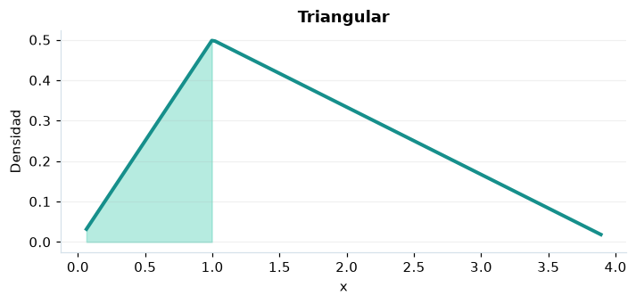

# Triangular

## Definición formal

Distribución acotada definida por mínimo $a$, máximo $b$ y moda $c$ con $a\le c\le b$. En AmPu 3.0 se parametriza exactamente como en `scipy.stats`;
los eventos fuera del soporte reciben masa/densidad 0.

## Parámetros y rango

| Parámetro | Significado | Rango | Valor de ejemplo |
|---|---|---|---|
| `a` | Límite inferior | sin límite; sin límite | `0.0` |
| `b` | Límite superior | sin límite; sin límite | `4.0` |
| `c` | Moda dentro de [a,b] | sin límite; sin límite | `1.0` |

## Función de densidad (PDF)

$$
f(x)=\begin{cases}\frac{2(x-a)}{(b-a)(c-a)},&a\le x<c\\\frac{2(b-x)}{(b-a)(b-c)},&c\le x\le b\\0,&\mathrm{en\ otro\ caso}\end{cases}
$$

## Función de distribución acumulada (CDF)

$$
F(x)=\begin{cases}0,&x<a\\\frac{(x-a)^2}{(b-a)(c-a)},&a\le x<c\\1-\frac{(b-x)^2}{(b-a)(b-c)},&c\le x\le b\\1,&x>b\end{cases}
$$

En general, la CDF es $F(x)=P(X\le x)$. Para una variable continua,
$P(a\le X\le b)=F(b)-F(a)$; para una discreta los extremos se incluyen
según los saltos de su CDF. Para una cola superior, consulte la función de supervivencia; no sume densidades continuas.

## Media, varianza y desviación estándar

$$
\operatorname{E}[X]=\frac{a+b+c}{3}
$$

$$
\operatorname{Var}(X)=\frac{a^2+b^2+c^2-ab-ac-bc}{18}
$$

$$
\sigma_X=\sqrt{\operatorname{Var}(X)}
$$

En modelos multivariados los momentos anteriores son **por componente**.
Si el momento no existe, la desviación tampoco está definida.

## Propiedades y casos especiales

Si $c=a$ o $c=b$, se interpreta la expresión por su límite; la moda está en un extremo.

*Figura 1. Curva teórica o primera marginal ilustrativa para Triangular; no sustituye a la densidad conjunta de un modelo multivariante.*

## Ejemplo resuelto, paso a paso

1. Configure `a=0.0`, `b=4.0`, `c=1.0` y el evento $x=1$.
2. Sustituya los parámetros en la fórmula de densidad (PDF); obtenga densidad (no probabilidad puntual) **0.5**.
3. Evalúe la CDF en ese mismo evento: **0.25**. Para una cola superior, consulte la función de supervivencia; no sume densidades continuas.
4. Interprete unidades y soporte antes de comunicar el resultado; la UI conserva todos los decimales internos.

## Referencias

- Ross, S. M. (2019). *A First Course in Probability* (10.ª ed.). Pearson.
- Casella, G., & Berger, R. L. (2002). *Statistical Inference* (2.ª ed.). Duxbury.
- Virtanen, P., et al. (2020). SciPy 1.0: Fundamental algorithms for scientific computing in Python. *Nature Methods, 17*, 261–272. https://doi.org/10.1038/s41592-019-0686-2
