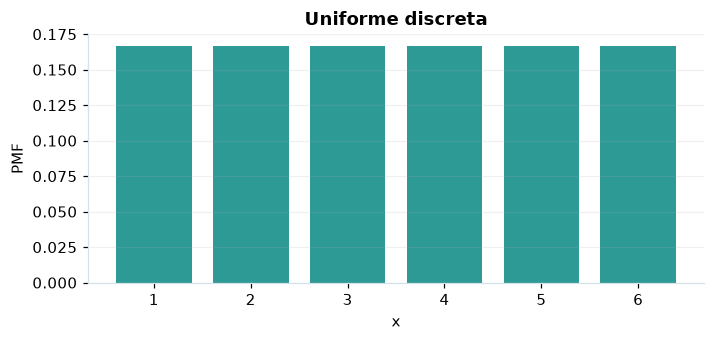

# Uniforme discreta

## Definición formal

Cada entero entre $a$ y $b$, ambos incluidos, tiene idéntica probabilidad. En AmPu 3.0 se parametriza exactamente como en `scipy.stats`;
los eventos fuera del soporte reciben masa/densidad 0.

## Parámetros y rango

| Parámetro | Significado | Rango | Valor de ejemplo |
|---|---|---|---|
| `a` | Primer entero | sin límite; sin límite | `1` |
| `b` | Último entero incluido | sin límite; sin límite | `6` |

## Función de masa (PMF)

$$
P(X=x)=\begin{cases}\dfrac{1}{b-a+1},&x\in\{a,\ldots,b\}\\0,&\mathrm{en\ otro\ caso}\end{cases}
$$

## Función de distribución acumulada (CDF)

$$
F(x)=\begin{cases}0,&x<a\\\dfrac{\lfloor x\rfloor-a+1}{b-a+1},&a\le x<b\\1,&x\ge b\end{cases}
$$

En general, la CDF es $F(x)=P(X\le x)$. Para una variable continua,
$P(a\le X\le b)=F(b)-F(a)$; para una discreta los extremos se incluyen
según los saltos de su CDF. Para una cola superior, consulte la función de supervivencia; no sume densidades continuas.

## Media, varianza y desviación estándar

$$
\operatorname{E}[X]=\frac{a+b}{2}
$$

$$
\operatorname{Var}(X)=\frac{(b-a+1)^2-1}{12}
$$

$$
\sigma_X=\sqrt{\operatorname{Var}(X)}
$$

En modelos multivariados los momentos anteriores son **por componente**.
Si el momento no existe, la desviación tampoco está definida.

## Propiedades y casos especiales

Cuando $a=b$ es una masa puntual. Para $a=1$ y $b=6$ representa un dado ideal.

*Figura 1. Curva teórica o primera marginal ilustrativa para Uniforme discreta; no sustituye a la densidad conjunta de un modelo multivariante.*

## Ejemplo resuelto, paso a paso

1. Configure `a=1`, `b=6` y el evento $x=3$.
2. Sustituya los parámetros en la fórmula de masa (PMF); obtenga probabilidad **0.166667**.
3. Evalúe la CDF en ese mismo evento: **0.5**. Para una cola superior, consulte la función de supervivencia; no sume densidades continuas.
4. Interprete unidades y soporte antes de comunicar el resultado; la UI conserva todos los decimales internos.

## Referencias

- Ross, S. M. (2019). *A First Course in Probability* (10.ª ed.). Pearson.
- Casella, G., & Berger, R. L. (2002). *Statistical Inference* (2.ª ed.). Duxbury.
- Virtanen, P., et al. (2020). SciPy 1.0: Fundamental algorithms for scientific computing in Python. *Nature Methods, 17*, 261–272. https://doi.org/10.1038/s41592-019-0686-2
