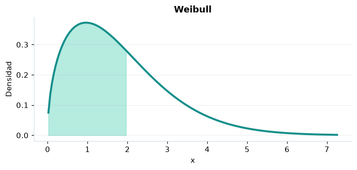

# Weibull

## Definición formal

Modelo de duración no negativa con forma $k$ y escala $\lambda$. En AmPu 3.0 se parametriza exactamente como en `scipy.stats`;
los eventos fuera del soporte reciben masa/densidad 0.

## Parámetros y rango

| Parámetro | Significado | Rango | Valor de ejemplo |
|---|---|---|---|
| `forma` | Forma k | > 0; sin límite | `1.5` |
| `escala` | Escala λ | > 0; sin límite | `2.0` |

## Función de densidad (PDF)

$$
f(x)=\frac{k}{\lambda}\left(\frac{x}{\lambda}\right)^{k-1}e^{-(x/\lambda)^k},\quad x\ge0
$$

## Función de distribución acumulada (CDF)

$$
F(x)=1-e^{-(x/\lambda)^k},\quad x\ge0
$$

En general, la CDF es $F(x)=P(X\le x)$. Para una variable continua,
$P(a\le X\le b)=F(b)-F(a)$; para una discreta los extremos se incluyen
según los saltos de su CDF. Para una cola superior, consulte la función de supervivencia; no sume densidades continuas.

## Media, varianza y desviación estándar

$$
\operatorname{E}[X]=\lambda\Gamma(1+1/k)
$$

$$
\operatorname{Var}(X)=\lambda^2\left[\Gamma(1+2/k)-\Gamma(1+1/k)^2\right]
$$

$$
\sigma_X=\sqrt{\operatorname{Var}(X)}
$$

En modelos multivariados los momentos anteriores son **por componente**.
Si el momento no existe, la desviación tampoco está definida.

## Propiedades y casos especiales

$k=1$ equivale a exponencial. Riesgo decreciente para $k<1$ y creciente para $k>1$.

*Figura 1. Curva teórica o primera marginal ilustrativa para Weibull; no sustituye a la densidad conjunta de un modelo multivariante.*

## Ejemplo resuelto, paso a paso

1. Configure `forma=1.5`, `escala=2.0` y el evento $x=2$.
2. Sustituya los parámetros en la fórmula de densidad (PDF); obtenga densidad (no probabilidad puntual) **0.27591**.
3. Evalúe la CDF en ese mismo evento: **0.632121**. Para una cola superior, consulte la función de supervivencia; no sume densidades continuas.
4. Interprete unidades y soporte antes de comunicar el resultado; la UI conserva todos los decimales internos.

## Referencias

- Ross, S. M. (2019). *A First Course in Probability* (10.ª ed.). Pearson.
- Casella, G., & Berger, R. L. (2002). *Statistical Inference* (2.ª ed.). Duxbury.
- Virtanen, P., et al. (2020). SciPy 1.0: Fundamental algorithms for scientific computing in Python. *Nature Methods, 17*, 261–272. https://doi.org/10.1038/s41592-019-0686-2
